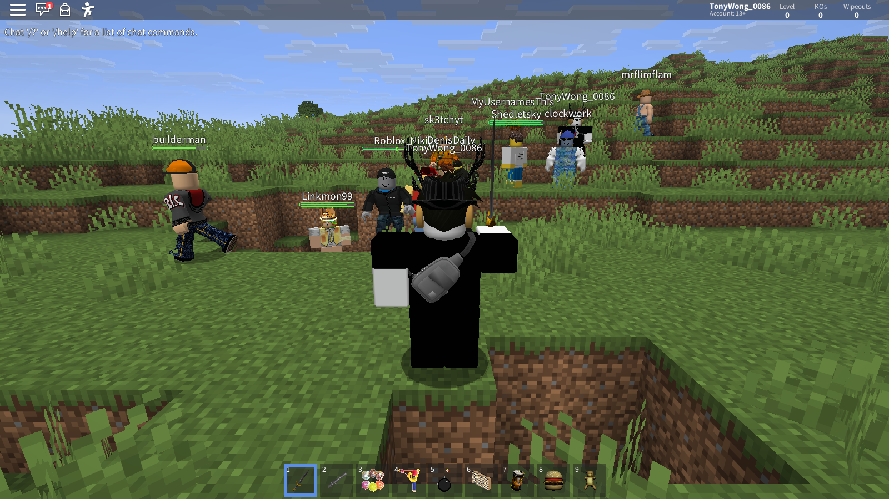
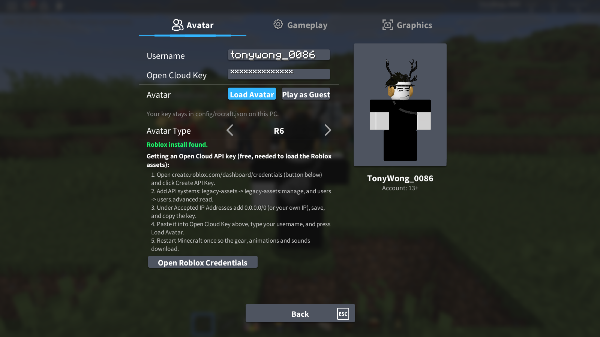

<div align="center">

# Rocraft

### 2018 Roblox, running inside Minecraft.

Your real Roblox avatar, the classic gear, the 2018 interface and Roblox physics, all inside a normal Minecraft world.

[](https://www.minecraft.net)
[](https://fabricmc.net)
[](https://adoptium.net)
[](LICENSE)

[**Quick start**](#quick-start) · [**Features**](#features) · [**What makes it different**](#what-makes-it-different) · [**Under the hood**](#under-the-hood) · [**Compatibility**](#compatibility) · [**FAQ**](#faq)



</div>

---

## At a glance

<table>
<tr>
<td width="33%" valign="top">

### Your real avatar
Built from Roblox's own meshes, not a reshaped Minecraft skin. R6 or R15, with your clothes, accessories, face, body package and Roblox's animations.

</td>
<td width="33%" valign="top">

### The classic gear
Linked Sword, Rocket Launcher, Superball, Trowel, coils, Hoverboard and more. Each is the real Roblox model, behaving the way its original script did.

</td>
<td width="33%" valign="top">

### The 2018 interface
Top bar, backpack hotbar, 2018 chat, notifications, the settings menu, the emote wheel and Roblox-style F3 stats.

</td>
</tr>
<tr>
<td valign="top">

### Roblox physics
Walk speed 16, Roblox jump height and gravity, worked out in studs and fitted to Minecraft's tick. Characters fall apart and "oof" when they die.

</td>
<td valign="top">

### Robloxian mobs
Shedletsky, builderman, Stickmasterluke and ten others roam the world in their real avatars or a chosen classic outfit.

</td>
<td valign="top">

### Nothing shipped, nothing hooked
No Roblox asset is in the jar. Everything loads from your own Roblox install and your own API key, and the Roblox client is never touched.

</td>
</tr>
</table>

---

## Quick start

> [!IMPORTANT]
> Rocraft needs **Roblox installed on the same PC** and a **free Roblox Open Cloud API key**. That's how it gets Roblox's assets without shipping any of them. Without them you get plain Minecraft visuals, the Guest's body colours, no animations and no gear models.

**Requirements:** Minecraft **26.3** · Fabric Loader **0.19+** · **Fabric API** · **Java 25** · Roblox Player or Studio · an Open Cloud API key

| Step | |
|:-:|---|
| **1** | **Install Roblox** and open it once so it finishes downloading. Rocraft finds it automatically: `%LOCALAPPDATA%\Roblox\Versions` on Windows, `Roblox.app` or `RobloxStudio.app` in Applications on macOS, and Sober, Vinegar or a Wine/Grapejuice prefix on Linux. |
| **2** | **Create an API key** ([how](#getting-an-api-key)). |
| **3** | **Install Fabric Loader** for 26.3, then put **Fabric API** and the **Rocraft jar** in your `mods` folder. Any launcher works; Modrinth App is tested. |
| **4** | **Launch the game.** Rocraft's settings open on first run: enter your Roblox username and key, then press **Load Avatar**. |
| **5** | **Restart once.** Rocraft builds the "Rocraft Roblox Assets" resource pack and turns it on. After the restart, the gear, animations and sounds are all in. |

### Getting an API key
1. Sign in at <https://create.roblox.com/dashboard/credentials> and click **Create API Key**.
2. Add these API systems and permissions:
   - **legacy-assets** → `legacy-assets:manage` (asset delivery);
   - **users** → `users.advanced:read`.
3. Under **Accepted IP Addresses**, add `0.0.0.0/0` (or your own IP), then save and copy the key.
4. Paste it in game: the **Rocraft** button next to Friends on the title screen, then the **Avatar** tab.

The same steps are in game, with a button that opens the credentials page and a check that Roblox is installed.

> [!CAUTION]
> Your key is stored **only** in `config/rocraft.json` on your PC, and it's never logged or sent anywhere except Roblox. **Don't share it.** If it leaks, regenerate it.

---

## Features

### Avatar
- **Your real Roblox avatar**, built from Roblox's own R6 meshes, with body colours, shirt and pants from your profile.
- **Body packages** (Robloxian 2.0, Man, Woman, Boy, Penguin and so on) use each part's R6 CharacterMesh, with your clothing wrapped on.
- **Accessories, faces and dynamic heads**, all loaded from Roblox. Layered clothing is left off, as Roblox does on R6.
- **Roblox's animations** (idle, walk, jump, fall, climb, sit, tool hold, slash, lunge) come from Roblox's own animation files, crossfaded the way the Animate script does.
- **R15:** switch **Avatar Type** to R15 in Settings → Avatar (R6 is the default). The body is assembled the way Roblox does it: the default rig from your install, your body packages' parts and joints swapped in, clothing laid on with Roblox's compositing meshes, and 2018 R15 Animate animations.
- **Emotes:** press `.` for Roblox's emote wheel, with your account's equipped emotes and their catalog thumbnails. The chat emotes `/e dance`, `/e wave`, `/e laugh`, `/e cheer` and `/e point` work too. As on Roblox, the wheel needs an R15 avatar.
- **The 2017 Guest:** with no username set, you play as the Guest (R cap, ROBLOX Jacket, Black Jeans). In multiplayer, other players with Rocraft appear as their own Roblox avatars.
- **Admin-style flying** in creative, like HD Admin / Adonis: the body faces wherever the camera looks.

### Classic gear
Everything is in the **Rocraft creative-inventory tab**, using the real Roblox model, grip, icon and sounds. Damage is scaled ×0.2, so Roblox's 100 health maps to Minecraft's 20.

<details>
<summary><b>Weapons</b></summary>

| Gear | What it does |
|---|---|
| Linked Sword | The blade hurts whatever it touches: 5 just held, 10 for half a second after a click (slash), 30 for a second after a quick double click (lunge). The lunge throws you a little forward and up |
| Rocket Launcher | 60 studs/s rocket, no gravity, trailing Roblox Fire. Explodes on contact: radius 8, 60 damage, knockback. Other projectiles can shoot it down |
| Superball | Random-colour ball at 200 studs/s, 25 damage. It bounces off everything, and the damage halves each time it hits a non-character |
| Slingshot | Red 1-stud pellet at 85 studs/s, no reload, 8 damage (it can hit you too), halved on each bounce |
| Paintball Gun | 300 studs/s paintball in one of 7 colours, 2 damage. Paints the Roblox Part it hits and splats paint that cleans up after 2 minutes |
| Bomb | The classic time bomb: a mirror ball that ticks faster and faster, then explodes. It rolls, bounces and gets kicked along |
</details>

<details>
<summary><b>Building and getting around</b></summary>

| Gear | What it does |
|---|---|
| Trowel | Builds a 12×4 wall of real studded Roblox Parts in one random BrickColor |
| Gravity Coil / Dual Gravity Coil | Cancels 75% / 85% of gravity while held |
| Speed Coil | Doubles your walk speed while held |
| Regeneration Coil | Heals 3 health every second while held |
| Green Balloon | Lifts you in slow surges, swelling as it rises, and pops 150 studs up |
| Blue Rolling Hoverboard | Drop it, step on and ride. W/S up to 35 studs/s, A/D turn, Space ollies, Shift steps off |
</details>

<details>
<summary><b>Food, fun and hats</b></summary>

| Gear | What it does |
|---|---|
| Bloxy Cola, Taco, Burger, Chicken, Pizza | Eat and drink with the Roblox poses and sounds |
| Teddy | Hug it and it says one of its classic lines |
| Save the Noobs Protest Sign | Shouts one of its three angry lines |
| Dominus Aureus, Dominus Rex, Doge, LOLHOO, Mr. Tentacles | Worn in the helmet slot, exactly where Roblox puts them |
</details>

**How it feels:**
- **No Minecraft arm swing.** Blasters fire on every click, and the rest keep their Roblox debounce (sword lunge 1 s, Bloxy Cola 3 s, food 0.8 s).
- **3D in first person:** you see the tool's Roblox model in your hand.
- **Roblox-style explosions** (flash, shockwave, fireball, sparks, smoke) tear blocks loose. The blocks fly, tumble and settle before turning into drops.

### Robloxian mobs
Shedletsky, Stickmasterluke, Roblox, builderman, Nikilis, clockwork, mrflimflam, DenisDaily, Linkmon99, PGHLego1945, TonyWong_0086, MyUsernamesThis and Sk3tchyt spawn rarely in the Overworld, each with a spawn egg.
- **Looks:** most wear their current avatar. Shedletsky wears Classic Telamon, builderman his "2015" outfit, MyUsernamesThis and Sk3tchyt their R15 outfits, and DenisDaily a fixed look.
- **Behaviour:** peaceful, like a Roblox NPC. They wander, look at you and run when hit.
- **Stats:** 100 health and walk speed 16, with Roblox footsteps, jump and landing sounds.
- **Knockouts:** they "oof" and fall apart into head, torso and limbs.

### Controls
| Input | Action |
|---|---|
| Mouse | Free cursor, drawn as Roblox's arrow |
| Right-drag / scroll | Rotate the camera / zoom from 0.5 to 400 studs (zoom all the way in for first person) |
| Left click | Use gear. Otherwise, mine or place on the **block under the mouse** |
| Right click | Minecraft "use" for non-Roblox items; never triggers gear |
| 1-9 or click a slot | Equip; press again to unequip |
| `.` | Emote wheel |
| `/` | Chat; `/?` lists the chat commands |
| F3 | Roblox-style stats |

### 2018 interface
- **Top bar** with menu, chat, backpack and emotes buttons, your name, a health bar and leaderstats (Level, KOs, Wipeouts).
- **Backpack hotbar:** only filled slots show. The equipped slot gets Roblox's blue inner border.
- **2018 chat** in SourceSans, with names coloured by Roblox's own name-colour algorithm. Messages fade after 30 seconds.
- **Roblox notifications** replace Minecraft's advancement and recipe toasts.
- **The 2018 settings menu**, with Avatar, Gameplay and Graphics tabs and a live render of your character.
- **F3 stats** in Roblox's Code font: budget meters for Physics, Render, GPU and Memory, a 240-frame graph, and Roblox-style FPS, World, Kernel, Graphics and Timing panels.



### Sound and effects
- **Roblox character sounds** from your install replace Minecraft's: footsteps, jump, landing, falling wind, climbing and swimming.
- **The "oof"**, and characters fall apart instead of falling over.
- **Gear sounds** from Roblox, from the sword's unsheath to the superball's boing.
- **Roblox's Fire, Smoke and Explosion effects**, built from the install's particle textures and colour ramps, with additive glow.

---

## What makes it different

**It's Roblox's data, not an imitation.** Rocraft doesn't approximate Roblox with Minecraft models. It reads Roblox's own file formats and runs them in Minecraft:
- **Meshes:** every Roblox `.mesh` version from 1.00 to 7.00, including the Draco-compressed geometry newer meshes use.
- **Models:** binary `.rbxm` and XML `.rbxmx` files, for gear, body packages, accessories and rigs.
- **Animations:** KeyframeSequences and the newer CurveAnimations, the format modern emotes use.
- **Textures, fonts and sounds:** DXT-compressed `.dds` particle textures, Roblox's fonts, and `.ogg` and `.mp3` sounds.

**Roblox's rules, not Minecraft's.**
- **Physics:** a Roblox Humanoid model in studs and seconds, mapped to Minecraft once, so jump heights and speeds match Roblox exactly.
- **Gear:** each tool follows its original script's numbers: speeds, damage, debounces and reloads.
- **Rigs:** R15 bodies are assembled with Roblox's own rig attachments and clothing compositing meshes.

**Built to stay fast.**
- **GPU-resident meshes:** each avatar mesh is uploaded to the GPU once. Each frame sends only its pose, colour and light. With 13 Robloxians in view, the frame work went from about 7.4 ms to 0.9 ms.
- **Roblox's own LODs:** meshes switch to their lower-detail versions with distance, as they do in Roblox.
- **Adaptive performance:** Rocraft watches its frame budget, and while it's over, it thins effects and animates far avatars less often.

**Respectful by design.**
- **No assets shipped:** nothing from Roblox is in the jar or this repository.
- **Hands off the Roblox client:** it is never launched, hooked or modified. Rocraft only reads files on your disk and calls Roblox's public web APIs with your own key.
- **Private storage:** assets are kept in your own Minecraft folder.

---

## Under the hood

| Layer | Technology |
|---|---|
| **Platform** | Minecraft 26.3 · Fabric Loader 0.19 · Fabric API · Fabric Loom (Gradle) |
| **Language** | Java 25: records, virtual threads for downloads, switch expressions |
| **Game integration** | SpongePowered Mixin: camera, mouse, input, HUD, chat, toasts, entity rendering, culling and frame limiting. The performance patches are optional, so the game still starts if one can't apply |
| **Rendering** | Minecraft's Blaze3D: custom render pipelines (triangle-topology entity cutout, additive particles), GPU-resident vertex buffers with per-draw uniform blocks, and Roblox mesh LODs |
| **Roblox formats** | Pure-Java readers with no Minecraft imports: `.mesh` v1–v7 with a Draco decoder (rANS, octahedral normals), `.rbxm`/`.rbxmx` with LZ4 chunks, KeyframeSequence and CurveAnimation, DXT1/3/5 `.dds` |
| **Roblox services** | Roblox Open Cloud and Asset Delivery (your own key), plus the public avatar, outfit and thumbnail endpoints |
| **Simulation** | A Roblox Humanoid model (studs, seconds, exact parabolic jumps) fitted to Minecraft's 20 Hz tick; ragdolls at 240 Hz |
| **Audio** | `.ogg` through Minecraft's decoder, `.mp3` through JLayer, as mono PCM so OpenAL positions it in 3D |
| **Text** | SourceSans, Inconsolata (Roblox's Code font) and Arial, rasterised into glyph atlases at the exact pixel size |
| **Assets at runtime** | A private resource pack ("Rocraft Roblox Assets") and an on-disk cache, both built on your machine |

<details>
<summary><b>Project layout</b></summary>

```
src/main/java/com/rocraft/
├── rbx/      Roblox file formats: RbxMesh, Draco, RbxModel, Lz4, RbxAnim, Dds, R6/R15 rigs
├── sim/      Roblox Humanoid physics and the Roblox → Minecraft mapping
├── tools/    The classic gear, Robloxian mobs, Roblox Parts, explosions and debris
└── mixin/    Server-side game patches
src/client/java/com/rocraft/client/
├── Avatar*, R15Body, Rig, Animator, Ragdoll    Characters and animation
├── MeshDraw, MeshGpu, *Renderer                Rendering
├── Hud2018, RobloxChat, EmoteWheel, Settings*  The 2018 interface
├── RobloxApi, RobloxProfile, RobloxPack        Roblox services and the asset pack
├── RbxAudio, RbxFont, RbxParticle              Sound, text and effects
├── Perf, FrameStats, RobloxStats               Performance and F3 stats
└── mixin/                                      Client patches
```
</details>

---

## Compatibility

Tested with these performance mods on Minecraft 26.2 (Fabric API 0.161.0): no mixin failures, and the avatar, HUD, chat, F3 panels, emote wheel and settings all render normally. They have not been re-tested on 26.3 yet.

| Mod | Version | Status | Notes |
|---|---|:-:|---|
| Sodium | 0.9.2 | Yes | F3 shows chunks and chunk builds as "by Sodium" |
| Sodium Extra | 0.9.4 | Yes | Turning particles off also hides Roblox's effects |
| Lithium | 0.25.3 | Yes | Roblox movement and gear physics unchanged |
| FerriteCore | 9.0.0 | Yes | Memory only |
| ImmediatelyFast | 1.16.5 | Yes | HUD, fonts and menus draw correctly |
| EntityCulling | 1.11.3 | Yes | Rocraft hands its entity culling over to it |
| MoreCulling | 1.8.1 | Yes | Needs Cloth Config |
| BadOptimizations | 2.4.1 | Yes | |
| Cloth Config | 26.2.155 | Yes | |

Rocraft also detects C2ME, ModernFix, Dynamic FPS, Iris, Krypton, Noisium and VMP and works alongside them, but these haven't been tested in game. When a mod already does one of Rocraft's built-in optimisations (entity culling, unfocused FPS limit), Rocraft steps aside and the setting shows "By <mod>".

---

## Settings

Everything is in the in-game **Settings** menu and saved to `config/rocraft.json`.

| Setting | Default | |
|---|---|---|
| `username` | | Your Roblox username |
| `apiKey` | | Your Open Cloud key (private) |
| `avatarType` | `R6` | `R6` or `R15` |
| `robloxMovement` | on | Roblox walk speed, jump height and gravity |
| `fallDamage` | off | Minecraft fall damage |
| `hunger` | off | Minecraft hunger |
| `hud2018` | on | The 2018 top bar, hotbar and chat |
| `robloxFont` | on | SourceSans text |
| `robloxCamera` | on | Roblox camera and mouse |

The **Graphics** tab adds:
- **Hide Unseen Entities:** don't draw entities hidden behind blocks.
- **Unfocused FPS Limit:** 30 FPS while the window isn't focused.
- **Adaptive Performance** (on): thin effects and far-avatar animation while over budget, and empty caches when the heap is over 85% full.
- **Stable Frame Pacing** (off): cap at a frame rate your slowest frames can hold.

---

## FAQ

<details>
<summary><b>Where do the Roblox assets come from?</b></summary>

From two places, both on your side:
1. **Your Roblox install** (Windows `%LOCALAPPDATA%\Roblox\Versions`, macOS `Roblox.app`, Linux Sober, Vinegar or Wine): R6 meshes, fonts, UI and particle textures, and character sounds.
2. **Roblox Open Cloud**, with your key: avatar items, animations, gear and hat models, textures, icons and sounds.

The oldest tools (Rocket Launcher, Superball, Slingshot, Bomb, Trowel, foods, Teddy) used built-in `rbxasset://` files that Roblox no longer ships. Roblox keeps website copies with normal asset IDs. Rocraft carries only that ID list and each tool's grip and size numbers (`classic_tools.json`), and downloads the rest. Everything is stored privately in your Minecraft folder: the resource pack, `config/rocraft/cache` and `config/rocraft/legacy`.
</details>

<details>
<summary><b>Will other players see my avatar?</b></summary>

Yes, if they have Rocraft too. When you join a world, Rocraft tells the server your Roblox username and rig (R6 or R15), and the server passes it to everyone else, so each player sees the others' real avatars and the emotes they play. This works on a dedicated server, on Open to LAN, and on worlds shared with e4all; the host just needs Rocraft installed. Players without Rocraft, or without a Roblox username set, appear as the 2017 Guest. Each viewer downloads the avatars with their own API key.
</details>

<details>
<summary><b>My game sits at exactly 60 FPS.</b></summary>

That's VSync matching a 60 Hz monitor (Video Settings → VSync, or your monitor's refresh rate in Windows display settings), not Rocraft. Press F3 to see Rocraft's own frame budget.
</details>

<details>
<summary><b>Does this touch my Roblox account or client?</b></summary>

No. The Roblox client is never launched, hooked or modified. Rocraft reads files from the install folder and calls Roblox's web APIs with the key you give it. The key has read access to assets and user profiles only.
</details>

---

## Known limitations
- Command suggestions (the `/` popup) don't show while the 2018 chat is on.
- Particle sizes and lifetimes are estimates.
- The hoverboard climbs one-block steps (Roblox's can't), so it doesn't get stuck on terrain. Only the rider hears its ride sounds.
- The Paintball Gun only recolours Roblox Parts, not Minecraft blocks.
- The balloon's lift is close to Roblox's but not exact, because Minecraft adds air drag.
- Fallen body parts and debris don't collide with each other.
- R15 characters fall apart as six R6-sized pieces, and the Settings picture and spawn eggs are drawn as R6. Avatar scaling and animation packs aren't applied yet.

---

## Build from source

```bash
./gradlew build          # → build/libs/rocraft-1.0.0.jar
./gradlew bench          # checks the movement physics against Roblox (jump height, tick fit, R6 rest pose)
./gradlew rbxDump        # dumps the contents of a Roblox model file
```

---

## Credits

- **Inspired by [@coah80](https://x.com/coah80)** on X.
- **Built with [Claude Code](https://claude.com/claude-code).** Rocraft is vibecoded: written almost entirely by AI from prompts, with every feature tested in game. Expect the occasional rough edge, and please report it.
- **Roblox**, its assets and the classic gear belong to **Roblox Corporation**. Minecraft belongs to **Mojang**.

<div align="center">

**MIT licensed** ([LICENSE](LICENSE)). The license covers Rocraft's code only, never Roblox's assets.

<sub>Rocraft is an unofficial fan project. It is not affiliated with, endorsed by or sponsored by Roblox Corporation or Mojang Studios.</sub>

</div>
